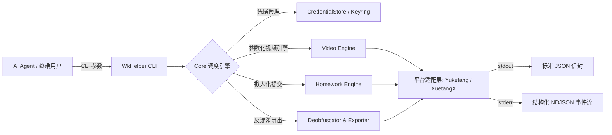

# WkHelper

[](https://www.python.org/)
[](https://github.com/astral-sh/uv)
[](https://github.com/astral-sh/ruff)
[](tests/)

面向 AI Agent 与自动化工作流的 Headless 网课自动化 CLI，支持**雨课堂**（`yuketang.cn` / 高校定制平台）与**学堂在线**（`xuetangx.com`）。

---

## 核心特性

- **Agent 原生交互契约**
  - **stdout**：单行严格 JSON 响应信封（含 `schema_version`、`ok`、`data` 与自引导 `next_actions`）。
  - **stderr**：结构化 NDJSON 实时事件通道（`video.progress`、`homework.progress`、`http.trace` 等），杜绝控制字符污染。
- **全平台多层章节树支持**
  - 递归遍历解析单层、多层嵌套大纲（章 / 节 / 小节 / 单元），精确识别全量叶子任务（视频、音频、课堂实录、作业、测验与期末考试）。
- **字体反混淆引擎**
  - 内置基于字形矢量特征的动态字体反混淆解析，自动还原雨课堂作业与测验题目中的加密字形与公式。
- **拟人化防风控体系**
  - **心跳抖动**：视频心跳间隔支持随机抖动（`--jitter`），消除周期性机器指纹。
  - **切换冷却**：跨视频支持设置间隔等待（`--video-delay`）。
  - **作业节流**：支持自定义并发（`--concurrency`，默认单线程）、逐题提交延迟（`--delay` / `--delay-jitter`）与乱序提交（`--random-order`）。
  - **浏览器指纹**：默认伪装 Chrome 的 TLS/JA3 与 HTTP/2 指纹（`WKHELPER_IMPERSONATE` 可切换目标或 `none`），UA 与指纹保持一致。
  - **网络出口**：全局支持指定代理通道（`--proxy`）与自定义浏览器标头（`--user-agent`，指定后会关闭指纹伪装）。
- **安全凭据存储**
  - 接入操作系统安全保管库（Windows Vault / macOS Keychain / SecretService），不以明文存储会话秘密；支持系统凭据或纯内存会话（`--credential-mode session`）。
- **完备的机器契约自省**
  - 提供 `wkhelper schema`，供 LLM Agent 按需自省命令规范、参数定义、副作用等级与调用示例。

---

## 架构概览



---

## 安装与快速上手

### 环境要求

- Python `>= 3.12`
- [`uv`](https://github.com/astral-sh/uv)（推荐）

### 安装

```bash
# 通过 uv 直接全局安装为独立 CLI 工具
uv tool install --force git+https://github.com/L-1124/WkHelper.git

# 或本地源码安装
git clone https://github.com/L-1124/WkHelper.git
cd WkHelper
uv sync
uv tool install --force .
```

---

## 常用命令与工作流

### 1. 账号认证 (`auth`)

```bash
# 微信扫码登录并自动在浏览器中打开二维码页面（支持 ykt / xtzx）
wkhelper auth login -p ykt -m qrcode --display browser --open-browser

# 导入 Cookie 文件登录（无图形环境）
wkhelper auth login -p xtzx -m cookie --cookie-file cookies.json

# 验证当前凭据有效性
wkhelper auth status -p ykt

# 查看本地存储的全部账号摘要（绝不输出敏感 Cookie）
wkhelper auth list
```

### 2. 课程查询 (`course`)

```bash
# 列出在学课程（返回包含 classroom_id 的唯一引用）
wkhelper course list -p ykt --limit 10

# 查看指定课程详细信息与元数据大纲
wkhelper course inspect -c 1966245:31318907
```

### 3. 视频学习与计划编排 (`video`)

```bash
# 查看待完成视频列表
wkhelper video list -c 1966245:31318907 --status pending

# 检查单视频进度与参数约束
wkhelper video inspect -c 1966245:31318907 -v 75369628

# 开启防风控参数执行视频学习（预览）
wkhelper video learn -c 1966245:31318907 -v 75369628 --jitter 0.2 --dry-run

# 正式执行视频推进（写操作强制要求 --confirm）
wkhelper video learn -c 1966245:31318907 -v 75369628 --jitter 0.2 --confirm

# 基于 JSON 计划文件批量执行，并记录断点检查点
wkhelper video learn --plan-file plan.json --checkpoint-file cp.json --confirm
```

> [!TIP]
> 批量执行支持断点续学。若因断网中断，追加 `--resume-from cp.json` 即可自动跳过已完成项继续推进。

### 4. 作业与题目检索 (`homework` / `question`)

```bash
# 查询未完成作业列表
wkhelper homework list -c 1966245:31318907 --status pending

# 导出整门课的作业及测试题目为 Markdown（供 LLM 分析解题）
wkhelper questions export -c 1966245:31318907 -o ./questions.md

# 查看单道题目的完整反混淆题干、选项与作答结果
wkhelper question get -c 1966245:31318907 -w 84704898 -q 73577720

# 模拟人类作答节奏提交作业（单线程 + 随机间隔 1.0~2.0 秒）
wkhelper homework submit -c 1966245:31318907 -w 84704898 \
  --answers '{"73577720": ["C"], "73577724": ["B"]}' \
  --concurrency 1 --delay 1.5 --delay-jitter 0.5 --confirm
```
### 5. 资料阅读与图文题 (`article`)

```bash
# 查看课程资料与图文任务列表
wkhelper article list -c 1966245:31318907 --status pending

# 标记指定资料节点为已读已完成（写操作要求 --confirm）
wkhelper article read -c 1966245:31318907 -a 84705076 --confirm
```

### 6. 讨论题互动打卡 (`discussion`)

```bash
# 查询全课讨论题及参与发言状态
wkhelper discussion list -c 1966245:31318907 --status pending

# 查看特定讨论题要求与教师引导题干
wkhelper discussion inspect -c 1966245:31318907 -d 84704891

# 提交讨论发言完成平时分打卡考核
wkhelper discussion reply -c 1966245:31318907 -d 84704891 \
  --content "今天的三件好事：第一，掌握了积极心理学的新视角..." --confirm
```

### 7. 契约自省 (`schema`)

```bash
# 查询所有命令列表与摘要索引
wkhelper schema

# 展开特定命令的完整参数契约、类型与示例
wkhelper schema --path "homework submit" --full
```

---

## 防风控参数配置

| 模块 | 参数 | 默认值 | 作用说明 |
|---|---|---|---|
| **全局** | `--proxy <url>` | 无 | 路由全局网络流量通过 HTTP / SOCKS5 代理出口 |
| **全局** | `--user-agent <ua>` | 伪装目标自带 | 指定真实浏览器 UA；与指纹伪装互斥，指定后回退为 libcurl 默认指纹 |
| **全局** | `--format <json\|md>` | 按 TTY 推断 | 强制输出格式，非 TTY 下默认 `json` |
| **全局** | `--credential-mode <system\|session>` | `system` | 凭据写入系统保险库，或仅驻留内存 |
| **全局** | `--data-dir <dir>` | 平台默认目录 | 凭据元数据与检查点数据目录 |
| **全局** | `--cookie-file <path>` | 无 | 会话 Cookie 文件，需配合 `--credential-mode session` |
| **作业提交** | `--concurrency <N>` | `1` | 严格限制并发提交数，默认单线程顺序提交 |
| **作业提交** | `--delay <sec>` | `1.5` | 单题作答基础间隔秒数，模拟人工思考 |
| **作业提交** | `--delay-jitter <sec>`| `0.5` | 提交间隔浮动范围，实际间隔为 `delay ± jitter` |
| **作业提交** | `--random-order` | `false` | 随机打乱题目提交次序，打破从第 1 题顺序作答的机械规律 |
| **视频学习** | `--jitter <ratio>` | `0.2` | 心跳间隔随机浮动比例（如 `1.5s ± 20%`） |
| **视频学习** | `--video-delay <sec>` | `3.0` | 批量学习时视频切换之间的冷却等待秒数 |

> 全局参数可置于子命令之前或之后，例如 `wkhelper --format md course list` 与
> `wkhelper course list --format md` 等价；同名命令级选项（如 `auth login --cookie-file`）优先归属该命令。

---

## 调试模式 (`--debug`)

追加全局 `--debug` 参数可激活面向 Agent 的结构化调试体系：

```bash
wkhelper --debug course inspect -c 97330:29593706
```

- **错误堆栈诊断**：错误信封中的 `error.details` 自动填充 `exception_type` 与结构化 `traceback` 数组；非调试模式下严格隐藏内部堆栈。
- **实时网络追踪**：stderr 通道以 NDJSON 输出 `http.trace` 追踪流（含请求方法、URL、响应状态码与微秒耗时），保持标准格式不被文本打乱。

---

## 开发与贡献

```bash
# 同步依赖并激活虚拟环境
uv sync

# 代码格式化与质量检查
uv run ruff check . --fix
uv run ruff format .
uv run pyrefly check

# 运行单元测试
uv run pytest -q
```

---

> [!WARNING]
> 本项目仅供技术研究、接口逆向学习与自动化流程测试使用。请使用者严格遵守各在线教育平台的用户协议与学校相关规定，切勿用于作弊或任何违规用途。
